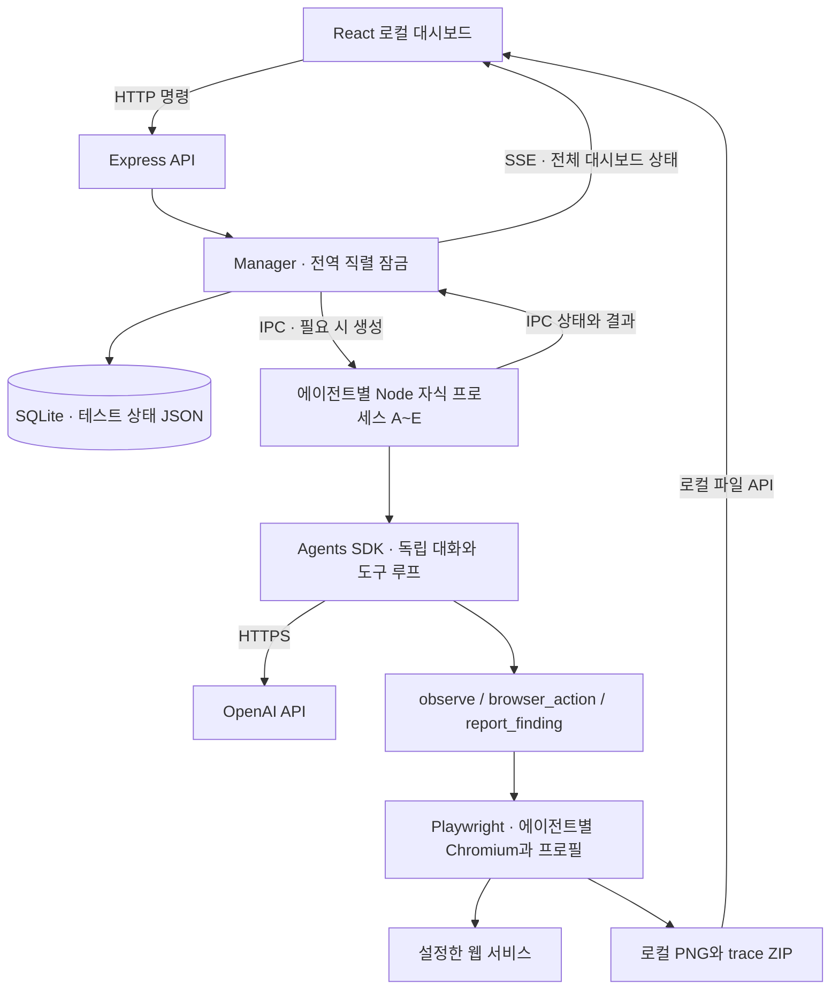

# 현재 아키텍처와 코드 안내

기준: 2026-10-26, 초기 구현 커밋 `8e140e2` 이후 고도화 반영. 아래 설명은 현재 소스 기준이다.

## 현재 변경 사항

텍스트 보고·종료·캡처의 최신 계약은 [TEXT_REPORTING.md](TEXT_REPORTING.md)를 함께 읽는다. 기본 PNG/trace는 꺼짐이다. R1~R8 수정 후의 구현이며 아래 내용도 현재 동작에 맞춰 갱신했다.

## 전체 구성



직렬 잠금은 **AI 작업 실행**을 제한한다. A~E의 브라우저는 로그인 준비를 위해 여러 개 열어 둘 수 있다. 열린 브라우저 수와 동시에 실행 중인 AI 수를 혼동하지 않는다.

## 디렉터리

```text
multi-agent-qa/
├─ README.md                  설치·사용·문서 시작점
├─ docs/                      배경·구조·프롬프트·보안·인계
├─ package.json               npm 명령과 고정 버전
├─ package-lock.json          재현 가능한 의존성 설치
├─ .env.example               비밀 값 없는 설정 템플릿
├─ .gitignore                 .env·.local·설치/빌드 결과 제외
├─ index.html
├─ vite.config.ts             UI 개발 서버와 /api 프록시
├─ tsconfig*.json
├─ shared/types.ts            AgentId·상태·결과·대시보드 타입
├─ src/
│  ├─ main.tsx
│  ├─ App.tsx                 에이전트 선택·프롬프트·제어·결과 UI
│  └─ styles.css              반응형 대시보드
├─ server/
│  ├─ index.ts                HTTP·SSE·파일/리포트 API, 접근 출처 검사
│  ├─ config.ts               환경 설정·키 마스킹·URL 검사
│  ├─ errors.ts               예상 가능한 입력·충돌 오류
│  ├─ environment.ts          worker/Chromium 환경변수 경계
│  ├─ feedback.ts             기록 기반 대체 피드백
│  ├─ manager.ts              직렬 실행·자식 프로세스·상태·DB 갱신
│  ├─ protocol.ts             부모/작업 프로세스 IPC 타입
│  ├─ worker.ts               SDK·프롬프트·도구·일시정지 경계
│  ├─ browser.ts              Chromium·DOM snapshot·액션·증거
│  ├─ store.ts                SQLite에 테스트 상태 저장/최근 상태 읽기
│  └─ report.ts               Markdown 통합 리포트
├─ scripts/install-browser.mjs
└─ .local/                    Git 제외 · 로컬에서만 생성
   ├─ qa.sqlite               SQLite DB, WAL/SHM 파일이 함께 생길 수 있음
   ├─ profiles/A~E/           로그인 프로필
   ├─ artifacts/              PNG·trace ZIP
   └─ browsers/               Chromium 바이너리
```

`dist/server/`, `dist/shared/`, `dist/web/`는 빌드 결과다. `node_modules/`는 `npm ci`로 설치한다. 소스와 별도로 옮기지 않아도 된다.

## 요청 흐름

### 설정과 로그인

- UI → `PATCH /api/settings`: URL·공통 지침을 저장한다.
- UI → `PATCH /api/agents/:id`: 역할·이번 프롬프트·계정 별칭을 저장한다.
- UI → `POST /api/agents/:id/browser`: 해당 worker를 준비하고 전용 브라우저를 연다.
- 사용자가 브라우저에서 직접 로그인한다. 별칭은 표시용이며 실제 계정이나 비밀번호가 아니다.
- 실행 중에는 대상 설정을 변경할 수 없다. 브라우저가 열려 있으면 주소 변경 전 새 테스트로 닫아야 한다.

### 실행

1. UI가 선택한 에이전트 설정을 저장하고 `POST /api/agents/:id/run`을 호출한다.
2. Manager가 다른 실행·초기화 여부, 키·모델 설정 여부, 빈 프롬프트를 확인한다.
3. IPC 전송 전에 `activeAgent`를 동기적으로 설정한다. 동시 요청은 409로 거부한다.
4. 선택한 worker에 이번 역할·프롬프트·공통 지침·본인의 저장 대화를 전달한다.
5. Worker가 브라우저와 trace를 준비하고 초기 DOM snapshot을 만든다.
6. SDK가 모델과 제공된 도구를 번갈아 실행한다.
7. Worker → Manager IPC 결과가 SQLite에 저장되고 SSE로 UI에 반영된다.
8. 작업 완료 시 waiting으로 대기하고 직렬 잠금을 해제한다. 사용자가 finish를 요청하면 잠금을 다시 얻고 도구 없는 피드백 요청 후 completed가 된다.

### 일시정지·중단

| 상태 | 의미 |
| --- | --- |
| idle | 아직 실행하지 않았거나 새 테스트 상태 |
| running | 준비·모델 판단·도구 실행 중 |
| pausing | 정지 요청 수신, 다음 체크포인트 대기 |
| paused | 모델 요청 또는 도구 실행 전 경계에서 대기 |
| stopping | 취소·worker 종료 대기, 직렬 잠금 유지 |
| waiting | AI 작업 종료, 사용자 추가 지시·최종 피드백 요청 대기 |
| summarizing | 조작 종료 후 피드백 정리 중, 직렬 잠금 유지 |
| completed | 최종 피드백 정리 완료 |
| failed | worker가 실패를 결과로 보고 |
| cancelled | 사용자 중단 또는 프로세스/서버 종료 |

`checkpoint()`는 모델 요청 직전과 도구 진입 시 일시정지를 확인한다. 진행 중 API 응답·브라우저 액션이 즉시 멈춘다는 보장은 없다. 중단은 AbortController를 취소하고 브라우저·worker를 종료한다. 부모는 3초 후 종료되지 않은 worker를 강제 종료한다.

재개 시 이전 ref는 무효화한다. finish는 API 취소 후 진행 중 브라우저 도구의 종료를 기다리고, 브라우저를 닫은 뒤 피드백을 만든다. 실패하면 기록 기반 보고서로 대체한다. 실행 시간 제한은 일시정지 시간도 포함한다. 중단·강제 종료는 이미 원격 서버에 전달한 쓰기 요청을 되돌리지 않는다.

## API 목록

| Method | 경로 | 기능 |
| --- | --- | --- |
| GET | /api/state | 현재 대시보드 상태 |
| GET | /api/events | SSE. 변경 시 전체 상태 전송, 주기적 keepalive |
| PATCH | /api/settings | URL·공통 지침 |
| PATCH | /api/agents/:id | 역할·프롬프트·별칭 |
| POST | /api/agents/:id/browser | 브라우저 열기/앞으로 가져오기 |
| POST | /api/agents/:id/run | 수동 실행 |
| POST | /api/agents/:id/pause | 일시정지 요청 |
| POST | /api/agents/:id/resume | 재개 |
| POST | /api/agents/:id/stop | 긴급중단 요청 |
| POST | /api/agents/:id/finish | 조작 종료 후 피드백 |
| POST | /api/tests/new | 새 테스트 |
| PATCH | /api/findings/:id | 사용자가 검증 상태 변경 |
| GET | /api/artifacts/:file | 허용된 이름의 PNG·trace ZIP |
| GET | /api/report?format=md | 현재 테스트 Markdown |
| GET | /api/report?format=json | 현재 테스트 JSON |

사용 가능한 에이전트 ID는 현재 `A~E` 상수다. 개수 편집 UI는 없다. 로컬 단일 사용자 용도이며 사용자 인증·원격 배포용 권한 체계는 없다.

## 저장과 복원

SQLite의 `tests(id, state, updated_at)` 테이블에 대시보드 상태 전체를 JSON으로 upsert한다. 정규화한 이벤트별 테이블은 아직 없다. 화면 이벤트는 최근 1,000건으로 제한한다.

대화 저장은 두 층이다.

| 위치 | 저장 내용 | 수명 |
| --- | --- | --- |
| worker의 sdkHistory | 도구 입출력을 포함한 SDK 이력 | 해당 worker가 살아 있는 동안 |
| Dashboard의 agent.history | 사용자 프롬프트·최종 응답·일부 실패/중단 메시지 | SQLite에 지속 |

서버 또는 worker 재생성 시 SDK 이력 전체를 재현하지 않는다. 저장된 사용자/에이전트 메시지로 새 SDK 입력을 만든다. 서버 재시작 시 중단된 작업을 자동 실행하지 않는다.

새 테스트에서는 이전 worker를 모두 종료한 뒤 새로운 테스트 ID와 빈 대화를 만든다. 로그인 프로필·기존 DB 행·원격 서비스 데이터는 남는다.

## 브라우저 도구의 실제 범위

- `observe`: 본문 텍스트 최대 14,000자와 요소 참조 목록을 제공한다.
- 가시성이 있고 허용된 요소를 최대 150개 보관한다.
- 관찰마다 노드에 묶인 handle과 의미 지문을 가진 ref를 만든다. 실행 직전 분리·의미·타입을 확인하고 액션 후 새 snapshot을 돌려준다. 순서 변경으로 다른 노드를 선택하지 않는다.
- AI는 DOM을 사용한다. PNG를 모델의 이미지 입력으로 전달하는 구현은 없다.
- `navigate`는 설정 URL과 같은 origin만 허용한다.
- 관찰·조작 시에도 현재 페이지 origin을 확인한다. 외부 인증은 수동이다.
- 정규화된 type으로 비밀번호·숨김·파일 필드를 관찰·실행에서 제외한다. 클릭/Enter의 연관 form과 목적지도 검사한다. 임의 셸·JavaScript 도구는 제공하지 않는다.
- 자동 팝업/새 탭 선택, iframe 탐색, canvas 기반 UI는 일반적으로 보장하지 않는다.
- 특정 위험 동작 라벨을 차단하지만 완전한 보안 경계는 아니다.

## 결과와 증거

Finding은 분류, 제목, 상세, 재현 절차, 심각도, 검증 상태, agent/run ID, 시각, 증거 파일명을 가진다.

AI가 `reproduced`를 보내도 `observed`로 낮춘다. 사용자만 대시보드에서 `reproduced`로 올릴 수 있다. 화면 증거는 관찰 근거이며 독립적인 원인 확인·서버 상태 검증을 대신하지 않는다.

기본 UI는 유형별 텍스트 보고다. PNG는 captureMode의 허용 시점에만 선택 저장하며 off에서는 PNG/trace를 생성하지 않는다. 영상 또는 일정 주기 자동 스트리밍이 아니다. 입력 영역을 마스킹하고 동일 화면 해시이면 파일을 재사용한다. Trace는 별도 ZIP이며 PNG의 마스킹이 trace 전체에 적용된다고 가정하지 않는다.

## 설정 기본값

| 변수 | 기본값·기능 |
| --- | --- |
| OPENAI_API_KEY | 필수, 기본 값 없음 |
| OPENAI_MODEL | 필수, 모델 ID를 사용자가 선택 |
| PORT | 4310 |
| MAX_TURNS | 25. 현재 범위 1~100 |
| RUN_TIMEOUT_SECONDS | 180. 현재 범위 10~1800초 |
| FEEDBACK_TIMEOUT_SECONDS | 45. 피드백 모델 요청 제한, 범위 5~180초 |
| HEADLESS | 기본 false. true면 검증용 비표시 브라우저 |
| QA_DATA_DIR | 기본 .local. 로컬 데이터 루트 재지정 |
| PLAYWRIGHT_BROWSERS_PATH | 기본 .local/browsers. 설치·실행에서 동일 경로 사용 |

configured는 키와 모델 문자열의 존재 여부만 확인한다. 실제 유효성·권한·비용 확인 API는 별도로 호출하지 않는다.

모델의 `parallelToolCalls: false`, `maxTokens: 2500` 및 SDK 도구 동시 실행 1을 설정한다. 모델별 지원 여부·실제 품질은 실제 키와 모델로 별도 확인해야 한다.

## 유지보수 시 우선 살펴볼 점

현재 확인된 제한 또는 후속 검토 항목이며 이번 문서화에서 로직을 바꾸지는 않았다.

- 재개 시 ref를 무효화하므로 모델은 재관찰해야 한다. 실제 모델의 재시도 준수는 별도 검증.
- SDK 도구 이력은 메모리만 유지한다. 장기 실행의 컨텍스트 관리·완전 복원은 미구현.
- SSE가 전체 상태를 보내고 DB도 전체 JSON을 쓴다. 기록 증가 시 성능 검토.
- 에이전트 수가 여러 UI와 상수에 5명으로 반영돼 있다. 인원 가변화는 별도 작업.
- 최초 탐색 실패의 부분 context는 정리한다. OAuth 팝업 복귀·창 수동 조작 등 실제 서비스의 복구 경로는 추가 검증.
- worker는 허용 목록만 상속하고 Chromium은 모델 키를 제외한다. OS 비밀 저장소 연동은 아직 없다. [SECURITY.md](SECURITY.md) 참조.
- 기존 테스트 결과를 다시 고르는 UI·API는 미구현이다.
